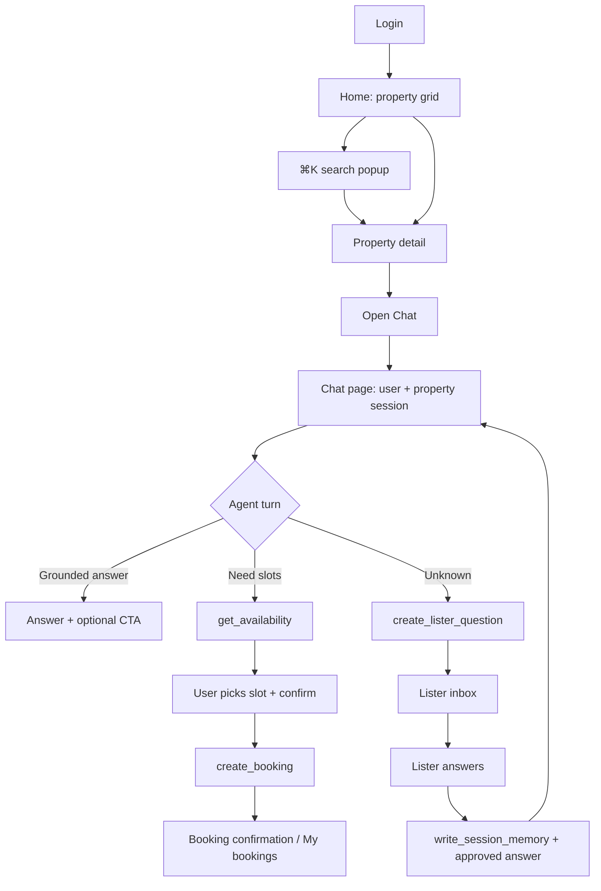

# Viewings AI Listing Chat — Implementation Plan

> **Status:** Agreed demo scope (standalone marketplace shell + listing chat)  
> **Stack:** Vite + React (TS) · Express + TypeScript · PostgreSQL + Prisma · OpenAI tool-calling agent  
> **Specs:** [Behaviour & Technical Spec](../../specs/Viewings_AI_Chat_Behaviour_and_Technical_Specification.md) · [Evidence Appendix](../../specs/Viewings_AI_Chat_Evidence_Appendix.md) · [Executive Decision Deck](../../specs/Viewings_AI_Chat_Executive_Decision_Deck.md)  
> **Rules:** [project-rules](../../rules/project-rules.md) · [typescript-standards](../../rules/typescript-standards.md) · [backend-folder-structure](../../rules/backend-folder-structure.md) · [frontend-folder-structure](../../rules/frontend-folder-structure.md) · [api-module-design](../../rules/api-module-design.md)  
> **UI:** Editorial Theme 02 — [design system](../../design-system/theme-02-editorial-design-system.md) · [instructions](../../design-system/theme-02-editorial-instructions.md) · [UI components plan](../reusable-ui-components/plan.md)

---

## 1. Goal

Build a **standalone demo marketplace** whose primary purpose is to prove **listing-scoped AI chat** behaviour from the Viewings specs:

1. Browse seeded rental and sale listings.
2. Open a property detail page.
3. Open a **full-page chat** bound to **(authenticated user + property)**.
4. Chat uses an **OpenAI tool-calling agent loop** against **real DB-backed tools** (no invented facts).
5. From chat, user can **view availability and book** a slot.
6. When the assistant cannot answer from verified data, it creates a **lister question**; once the lister answers, that knowledge is written into **session context memory** so the same question is not re-escalated.
7. Demo UX includes a **control panel**, **evidence “Try this” sidebar**, **bookings**, and **lister unanswered-question inbox**.

This is **one delivery** (multiple build steps, not phased releases). No automated QA harness. Acceptance is manual walkthrough of Kenil evidence cases via the sidebar chips.

---

## 2. In scope / out of scope

### In scope

| Area | Decision |
|------|----------|
| Surfaces | **Listing chat only** |
| Marketplace shell | Home grid + ⌘K search popup, property detail, chat route, bookings |
| Auth | Email/password JWT; seed users so the site is not open |
| Data | PostgreSQL seed: **10 rentals + 10 sales**; all actions persist to DB |
| AI | Live OpenAI only; model via env (`GPT-5.6 Luna` / `OPENAI_MODEL`) |
| Orchestration | Tool-calling **agent loop** |
| API | **REST only**; one complete JSON response per turn (no streaming) |
| Session store | Postgres only (**no Redis**) |
| Knowledge | Structured listing fields + approved answers + **chat session context memory** (**no RAG**) |
| Language | **English only** |
| Timezone | **Pacific/Auckland (NZ)** for slots, relative dates, display |
| Soft delete | Required on primary entities |
| Design | Strict **Editorial Theme 02** |

### Out of scope (explicitly deferred)

- Agent-profile chat
- Global “Ask AI” discovery surface as its own product page (search stays ⌘K popup only)
- Separate Agent Prisma model
- Redis / n8n / CRM / emails / real calendar sync
- Offline / no-key mock AI mode
- Multilingual (Hindi/Gujarati) cases
- Formal automated test matrix UI / CI acceptance gate
- RAG over PDFs or free-text neighbourhood invention

---

## 3. Product behaviour contract (from specs)

Every chat turn must follow:

**Understand → Verify → Answer → Act**

| Rule | Meaning for this demo |
|------|------------------------|
| LLM understands language | Intent, entities, canonical attributes via tool-calling agent |
| DB/tools are truth | No property fact without listing field, approved answer, session memory, or successful tool result |
| Answer before CTA | Resolve the question; then one contextual action |
| Unknown is valid | Say “not specified”; offer escalate to lister; log unanswered question |
| Listing-type gating | Rental pet/bond language must not be applied to **sale** listings |
| Regex demoted | Phone/email/STOP/booking-ref validation only — not semantic routing |
| Action integrity | Never claim “booked” / “sent to lister” unless the tool succeeded |

Canonical attribute examples the agent must map correctly (Evidence E-02…E-07):

| User wording | Canonical attributes |
|--------------|----------------------|
| “Do I need to buy a bed?” | `furnishing` / `included_furniture` |
| “Can my dog play outside?” | `outdoor_space` + `fencing` + `pets_policy` |
| “Does the bedroom connect to the bathroom?” | `ensuite` / `bathroom_layout` |
| “Does it stay warm?” | `heating` / `insulation` (not cooling alone) |
| Wheelchair visit | `accessibility` / `step_free_access` — no overclaim |
| Pet-friendly on **sale** | Ownership + body-corporate restrictions — not rental pets policy |

---

## 4. End-to-end user flows



### Flow A — Browse → chat

1. Authenticated seeker lands on home.
2. Sees seeded listings (filters: rent/sale, beds, suburb via ⌘K).
3. Opens `/properties/:id`.
4. Clicks **Chat about this property** → `/chat/:propertyId` (creates or resumes `ChatSession` for this user+property).

### Flow B — Property Q&A

1. User sends natural-language question.
2. Backend runs OpenAI agent loop with tools against that property.
3. Response JSON includes message text, `answer_status`, facts/sources, CTAs, and debug payload for the demo panel.
4. Messages + turn log persisted.

### Flow C — Book from chat

1. User asks for times or clicks **View available times**.
2. Agent calls `get_availability`; UI renders slot buttons.
3. User confirms; agent (or dedicated REST confirm) calls `create_booking` with contact fields as needed.
4. Redirect or deep-link to booking confirmation; booking also listed under **My bookings**.

### Flow D — Lister escalation + memory

1. Agent cannot ground an answer → creates `UnansweredQuestion` / lister request (tool success required before saying “I sent this”).
2. Lister opens inbox, sees property + question, submits answer.
3. System stores:
   - `ApprovedAnswer` (reusable at property level where appropriate), and
   - **Session context memory** on that chat session (and preferably property-scoped memory the agent can read next turn).
4. Next similar question: agent reads memory / approved answer and responds **without** re-escalating.

---

## 5. Frontend routes & pages

**App:** Vite + React + React Router + TypeScript. Strict Editorial tokens/components.

| Route | Page | Purpose |
|-------|------|---------|
| `/login` | Login | Email/password |
| `/` | Home | Property grid; ⌘K / Ctrl+K command search popup (not a separate search page) |
| `/properties/:propertyId` | Property detail | Photos, facts, price, attributes summary; CTA to open chat |
| `/chat/:propertyId` | **Full-page chat** | Session for current user + property; evidence sidebar; booking CTAs |
| `/bookings` | My bookings | List user’s bookings |
| `/bookings/:bookingId` | Booking confirmation | Single booking detail |
| `/lister/questions` | Lister inbox | Unanswered / answered questions for properties they own |
| `/demo` | Demo control panel | Switch fixture property focus, inspect last turn logs, seed reset hint, feature flags |

### Chat page layout (desktop + mobile)

- **Main:** conversation thread + composer (full page, not side drawer).
- **Sidebar (desktop) / sheet (mobile):** “Try this” evidence prompts grouped by failure family (E-01…E-11). Clicking a chip **sends that message** into the current session.
- **Optional debug strip** (demo flag): intent, attributes, sources, `answer_status`, tools called, CTA chosen.
- Structured action buttons from API (`view_available_times`, `select_slot`, `ask_lister`, `confirm_booking`).

### Command search popup

- Spotlight-style modal on Home (and globally when logged in).
- Filters: text, listing type, bedrooms, suburb, price band.
- Results navigate to property detail.

### Auth gate

- All marketplace/chat routes require auth.
- Seeded accounts only (see §9).

---

## 6. Backend architecture

**App:** Express + TypeScript + Prisma + Zod. Module layout per `docs/rules/backend-folder-structure.md` and `api-module-design.md`.

### Modules

| Module | Responsibility |
|--------|----------------|
| `auth` | Register (disabled in demo or admin-only), login, JWT, `me` |
| `users` | Profile read (minimal) |
| `properties` | List, get by id, command-search filters |
| `chat` | Create/resume session, list messages, **POST message → orchestrator**, session memory read |
| `bookings` | Availability read (optional REST), create/cancel, list mine, get one |
| `lister` | List unanswered questions, answer question, publish to approved + memory |
| `leads` | `ContactLead`, `CallbackRequest` capture |
| `demo` | Turn log fetch, fixture helpers for control panel |
| `ai` (internal) | OpenAI client, tool definitions, agent loop, NZ date helpers, listing-type policy, CTA policy |

### Core REST endpoints (illustrative)

```
POST   /api/auth/login
GET    /api/auth/me

GET    /api/properties
GET    /api/properties/:id

GET    /api/chat/sessions/:propertyId          # get or create session for me+property
GET    /api/chat/sessions/:sessionId/messages
POST   /api/chat/sessions/:sessionId/messages  # { content } → full assistant JSON turn

GET    /api/properties/:id/availability
POST   /api/bookings
GET    /api/bookings
GET    /api/bookings/:id
POST   /api/bookings/:id/cancel

GET    /api/lister/questions
POST   /api/lister/questions/:id/answer

POST   /api/leads/contact
POST   /api/leads/callback

GET    /api/demo/turns/:sessionId              # structured logs for control panel
```

All mutating routes: authenticate → validateDto → controller → service. Soft-deleted rows excluded by default.

---

## 7. Data model (Prisma)

> Soft delete: `deletedAt DateTime?` on listed models. Timestamps: `createdAt` / `updatedAt`. IDs: `cuid()` strings unless noted.

### Enums

- `UserRole`: `SEEKER` | `LISTER` | `DEMO_ADMIN`
- `ListingType`: `RENTAL` | `SALE`
- `AnswerStatus`: `VERIFIED` | `LIMITED` | `UNKNOWN`
- `QuestionStatus`: `OPEN` | `ANSWERED` | `DISMISSED`
- `BookingStatus`: `CONFIRMED` | `CANCELLED`
- `MessageRole`: `USER` | `ASSISTANT` | `SYSTEM`
- `LeadStatus`: `NEW` | `HANDLED`

### Models

#### `User`

- `id`, `email` (@unique), `passwordHash`, `name`, `role`
- Relations: sessions, bookings, ownedProperties, answeredQuestions, contactLeads, callbacks
- Soft delete

#### `Property`

- Core listing: `title`, `slug`, `listingType`, `status`, `suburb`, `city`, `addressLine`, `bedrooms`, `bathrooms`, `parking`, `rentWeekly`?, `bond`?, `price`?, `availableFrom`?, `description`, `heroImageUrl`, `imageUrls` (Json)
- `listerId` → `User` (the lister who receives escalations — **no Agent model**)
- Soft delete
- Relations: attributes, slots, bookings, sessions, unansweredQuestions, approvedAnswers

#### `ListingAttribute`

- `propertyId`, `key` (canonical attribute name), `value` (Json or string), `confidence`?, `source` (`LISTING` | `LISTER_APPROVED` | `SEED`)
- `@@unique([propertyId, key])`
- Soft delete

Canonical keys to seed/support (minimum for evidence cases):

`furnishing`, `included_furniture`, `heating`, `cooling`, `insulation`, `outdoor_space`, `fencing`, `pets_policy`, `ensuite`, `bathroom_layout`, `internet`, `fibre_status`, `workspace`, `accessibility`, `step_free_access`, `lift`, `body_corporate_pets`, `weekly_rent`, `bond`, `parking_detail`

#### `AvailabilitySlot`

- `propertyId`, `startsAt`, `endsAt`, `timezone` default `Pacific/Auckland`, `isBooked`, `bookingId`?
- Soft delete

#### `Booking`

- `propertyId`, `userId`, `slotId`, `status`, `contactName`, `contactEmail`, `contactPhone`?, `notes`?
- Soft delete

#### `ChatSession`

- `userId`, `propertyId`
- `@@unique([userId, propertyId])`
- **`contextMemory` Json** — structured key/value facts learned in this session (and mirrored from lister answers), e.g.:

```json
{
  "facts": [
    {
      "attribute": "lister_name",
      "value": "Jason",
      "source": "lister_answer",
      "questionId": "...",
      "updatedAt": "2026-08-05T..."
    }
  ],
  "prefs": {
    "viewing_intent": { "date_iso": "2026-08-08", "window": "09:00-14:00" }
  },
  "last_topic": "fencing"
}
```

- Soft delete

#### `ChatMessage`

- `sessionId`, `role`, `content`, `actions` Json?, `answerStatus`?, `metadata` Json?
- Soft delete

#### `TurnLog`

- One row per assistant turn for demo/debug/QA inspection
- `sessionId`, `userMessageId`, `assistantMessageId`
- `intents` Json, `attributes` Json, `entities` Json
- `toolsCalled` Json, `sources` Json, `answerStatus`, `cta` Json
- `rawModelTrace` Json? (truncated), `latencyMs`
- Soft delete optional (prefer keep for demo)

#### `ApprovedAnswer`

- Property-level reusable answers after lister approval
- `propertyId`, `canonicalAttributes` String[], `questionPattern`?, `answerText`, `approvedById`, `approvedAt`, `expiresAt`?
- Soft delete

#### `UnansweredQuestion`

- `propertyId`, `sessionId`?, `userId`?, `status`
- `questionText`, `resolvedIntent`?, `canonicalAttributes` Json?
- `answerText`?, `answeredById`?, `answeredAt`?
- Soft delete

#### `ContactLead`

- `userId`?, `propertyId`?, `name`, `email`, `phone`?, `purpose`, `consent`, `status`
- Soft delete

#### `CallbackRequest`

- `userId`?, `propertyId`?, `listerId`, `preferredTime`?, `contact`, `notes`?, `status`
- Soft delete

### Indexing

- `Property(listingType, suburb, bedrooms)`
- `AvailabilitySlot(propertyId, startsAt)`
- `UnansweredQuestion(status, propertyId)`
- `ChatSession(userId, propertyId)` unique

---

## 8. AI orchestrator & tools

### Runtime

1. Load session + property + attributes + recent messages + `contextMemory` + relevant `ApprovedAnswer`s.
2. Build system instructions: grounding rules, listing-type policy, NZ timezone, English, CTA rules, “never invent facts”.
3. Run **OpenAI tool-calling agent loop** until final message (cap tool iterations, e.g. 6).
4. Apply deterministic post-checks: listing-type gate, no fake booking language, CTA selection from `answer_status`.
5. Persist `ChatMessage` (assistant), `TurnLog`, update `contextMemory` if tools wrote facts.
6. Return single REST JSON:

```json
{
  "message": { "id": "...", "role": "assistant", "content": "..." },
  "answer_status": "verified",
  "facts": [{ "attribute": "furnishing", "value": "unfurnished", "source": "listing_attribute" }],
  "actions": [{ "type": "view_available_times", "label": "View available times" }],
  "debug": { "intents": [], "attributes": [], "tools": [], "cta": "..." }
}
```

### Tool set (minimum)

| Tool | Behaviour |
|------|-----------|
| `get_property` | Structured facts + attributes for `property_id` |
| `search_listings` | Filtered listing summaries (for in-chat discovery helpers if needed; home search can also use REST) |
| `get_availability` | Real bookable slots in NZ time for date range |
| `create_booking` | Validate slot free → create booking → mark slot booked; return confirmation payload |
| `cancel_booking` | Cancel owned booking; free slot |
| `send_question_to_lister` | Create `UnansweredQuestion`; return delivery status (**required before claiming sent**) |
| `capture_contact` | Create `ContactLead` with consent |
| `request_callback` | Create `CallbackRequest` |
| `read_session_memory` | Return `ChatSession.contextMemory` (+ optional property approved answers) |
| `write_session_memory` | Upsert facts into `contextMemory` (used after lister answer and for stable prefs like viewing intent) |
| `get_approved_answers` | Fetch property approved answers matching attributes |

When a lister answers via `/lister/questions/:id/answer`, the **service** (not only the model) must:

1. Mark question `ANSWERED`.
2. Upsert `ApprovedAnswer`.
3. Call the same write path as `write_session_memory` for the originating session (and optionally all open sessions on that property for that attribute).

### Deterministic helpers (non-LLM)

- NZ relative date resolution (`Saturday morning`, etc.) → ISO ranges in `Pacific/Auckland`.
- Weekly rent / bond breakdown from numeric fields only.
- Sale vs rental policy gate before composition.
- CTA picker after `answer_status` is known.
- Regex hooks: email/phone extraction for contact capture; booking reference shape; STOP.

### Model config

```env
OPENAI_API_KEY=
OPENAI_MODEL=gpt-5.6-luna
OPENAI_TIMEOUT_MS=60000
TZ=Pacific/Auckland
```

> If the provider’s exact model string differs, keep `OPENAI_MODEL` as the single switch — do not hardcode in services.

---

## 9. Seed data

### Users

| Email | Role | Purpose |
|-------|------|---------|
| `seeker@viewings.demo` | `SEEKER` | Primary chat/booking user (“John”) |
| `lister@viewings.demo` | `LISTER` | Owns seeded properties; answers inbox |
| `admin@viewings.demo` | `DEMO_ADMIN` | Control panel access |

Shared demo password in `.env.example` (e.g. `DemoPass123!`).

### Properties

- **10 RENTAL** + **10 SALE**
- Cover Auckland suburbs; varied bedrooms/prices
- Explicit fixture properties for evidence cases (recommend tagging `fixtureKey` in seed metadata or slug):
  - Unfurnished rental (bed / furnishing)
  - Yard + pets negotiable + fencing **unknown**
  - Ensuite known / unknown layout
  - Heating present, cooling present, insulation missing
  - Accessibility / step-free **unknown** (critical grounding)
  - Sale listing with/without body-corporate pet notes
  - Rental with clear weekly rent + bond + available_from
  - At least one with rich outdoor / WFH attributes for “preserve positive” cases

### Slots

- Each property: several future slots in NZ time (weekday mornings/evenings).
- Some pre-booked to prove conflict handling.

### Attributes

- Dense attribute rows on fixture properties; thinner on filler listings (to exercise UNKNOWN → escalate).

---

## 10. Evidence “Try this” sidebar

No automated test runner. Provide **manual chips** on the chat page that inject exact user messages.

Map at least:

| ID | Chip label | Message | Fixture property |
|----|------------|---------|------------------|
| E-01 | Greeting | `Hello` | any |
| E-02 | Buy a bed? | `Do I need to buy a bed?` | unfurnished rental |
| E-03 | Dog outside | `Can my dog play outside?` | yard + fencing unknown |
| E-04 | Ensuite | `Does the bedroom connect to the bathroom?` | layout fixture |
| E-05 | Stay warm | `Does it stay warm?` | heating fixture |
| E-06 | Wheelchair | `My father uses a wheelchair. Can he visit?` | accessibility unknown |
| E-07 | Sale pets | `I don't like pets - is it pet-friendly?` | **sale** fixture |
| E-08 | Wheelchair variant | Alternate phrasing | same as E-06 |
| E-09 | CTA order | Same as E-06 focus | accessibility unknown |
| E-10 | Unknown / escalate | `Why is the owner moving?` | no attribute |
| E-11 positives | Weekly rent / move-in / WFH / BBQ | curated | matching fixtures |

Chip click may also navigate to the correct fixture `propertyId` when the current listing cannot demonstrate the case (demo helper).

---

## 11. Frontend feature map

| Feature | Notes |
|---------|--------|
| Auth screens | Editorial forms; JWT in memory + httpOnly cookie **or** secure local storage per project auth pattern — prefer httpOnly cookie if CORS allows |
| Home grid | Cards using design-system components; rent/sale badge |
| ⌘K search | Command menu pattern; keyboard accessible |
| Property detail | Full-bleed imagery per Editorial rules where applicable; facts list; Chat CTA |
| Chat | Full page; message list; CTA buttons; evidence sidebar; mobile sheet |
| Bookings | Table/list + detail confirmation |
| Lister inbox | Queue + answer form |
| Demo panel | Last `TurnLog`, env model name, fixture jump links |

Reuse `client/src/components/ui/*` per project rules; do not invent one-off buttons/inputs.

---

## 12. Build steps (single delivery)

Execute in order; ship as one working demo when complete.

### Step 0 — Foundations

- Scaffold `server` (Express TS) and `client` (Vite React TS)
- ESLint/TS strict; shared env examples
- Prisma init + PostgreSQL connection
- Editorial tokens + Tailwind/CSS variables on client
- Auth module + seed users

### Step 1 — Marketplace data plane

- Prisma models + soft delete middleware/helpers
- Seed 20 properties, attributes, slots
- Properties list/detail APIs
- Home grid + ⌘K search + property detail UI

### Step 2 — Chat sessions & messages

- Session unique on (user, property)
- Message CRUD; empty `contextMemory`
- Full-page chat UI shell + evidence sidebar (chips send static text)

### Step 3 — AI agent + grounding tools

- OpenAI client + tool registry
- Implement `get_property`, `read_session_memory`, `write_session_memory`, `get_approved_answers`
- Listing-type + answer-status + CTA policies
- `POST .../messages` returns structured JSON; persist `TurnLog`
- Wire debug strip / demo panel

### Step 4 — Booking tools & pages

- `get_availability`, `create_booking`, `cancel_booking`
- Chat slot buttons + confirmation
- My bookings + booking detail pages
- Contact capture tool where booking needs details

### Step 5 — Lister escalation loop

- `send_question_to_lister`, `request_callback`, `capture_contact`
- Lister inbox UI + answer endpoint
- On answer: `ApprovedAnswer` + `write_session_memory`
- Prove E-10: second ask uses memory, no duplicate open question

### Step 6 — Demo hardening

- Demo control panel
- Fixture jump from evidence chips
- Mobile pass on all routes
- Seed script idempotent (`prisma migrate` + `db seed`)
- README: how to run, login accounts, which fixtures map to which evidence IDs

---

## 13. Environment & run

```env
# server/.env
DATABASE_URL=postgresql://...
JWT_SECRET=
OPENAI_API_KEY=
OPENAI_MODEL=gpt-5.6-luna
APP_URL=http://localhost:5173
API_URL=http://localhost:3000
DEMO_SEEKER_EMAIL=seeker@viewings.demo
DEMO_LISTER_EMAIL=lister@viewings.demo
DEMO_PASSWORD=DemoPass123!
TZ=Pacific/Auckland
```

```bash
# typical local
cd server && npm run dev
cd client && npm run dev
```

---

## 14. Manual acceptance checklist (demo)

Walk these without an automated harness:

- [ ] Login as seeker; home shows 20 listings; ⌘K finds by suburb/type
- [ ] Property detail → chat opens session unique to user+property
- [ ] E-02…E-07 chips produce correct attribute routing and **no invented facts**
- [ ] Sale pet question does **not** use rental pets policy
- [ ] Accessibility unknown → honest unknown + ask lister CTA (no slot dump first)
- [ ] Ask unknown → lister question created in DB → lister answers → memory updated → re-ask answered from memory
- [ ] Availability → book → booking row + confirmation page; double-book blocked
- [ ] Cancel booking frees slot
- [ ] TurnLog visible in demo panel for a turn (intent/attributes/tools/CTA)
- [ ] Mobile layouts usable for home, detail, chat, bookings, lister inbox
- [ ] Soft-deleted entities never appear in default queries

---

## 15. Directory targets

```
client/                 # Vite + React + TS
server/                 # Express + TS + Prisma
docs/plan/ai-chat-system/plan.md   # this file
docs/specs/             # behaviour source of truth
docs/rules/             # coding standards
docs/design-system/     # Editorial Theme 02
```

Keep `client` and `server` **separate** (no shared package). Duplicate DTO types carefully on the client as needed, or generate OpenAPI later — out of scope for v1 unless trivial.

---

## 16. Decisions locked from discovery

| Topic | Decision |
|-------|----------|
| Demo shape | Marketplace shell + listing chat |
| Surfaces | Listing only |
| Frontend | Vite + React |
| Backend | Express + TS |
| DB | PostgreSQL + Prisma; seed everything |
| Seed volume | 10 rental + 10 sale |
| Chat UX | Full page route `/chat/:propertyId` |
| Search UX | ⌘K popup, not a page |
| Auth | Email/password; seeded users |
| AI | Live OpenAI tool-calling loop |
| Transport | REST complete JSON |
| Session | Postgres `contextMemory` Json; no Redis |
| Knowledge | No RAG |
| Lister loop | Unanswered → answer → memory + approved |
| Agent model | Removed; lister is a `User` |
| Design | Editorial Theme 02 |
| Delivery | One build, sequenced steps |
| Tests | Manual evidence chips only |

---

**Next action after this plan:** implement Step 0 foundations when you ask to start building.
`)