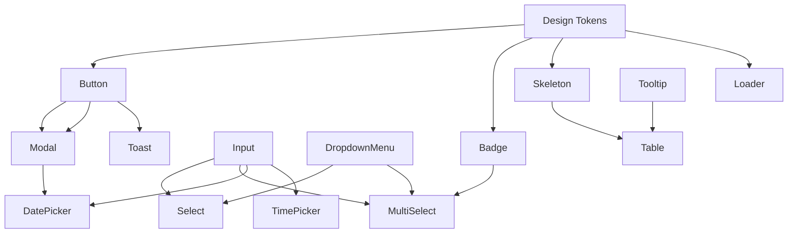

# Reusable UI Components — Implementation Plan

> **Design system:** Editorial (Theme 02)  
> **Location:** `client/src/components/ui/`  
> **References:** [theme-02-editorial-design-system.md](../../design/theme-02-editorial-design-system.md) · [theme-02-editorial-instructions.md](../../design/theme-02-editorial-instructions.md) · [project-rules.md](../../rules/project-rules.md) · [typescript-standards.md](../../rules/typescript-standards.md)

---

## Non-Negotiable Requirements

**Every component in this plan must be:**

| Requirement | Definition |
|-------------|------------|
| **Responsive** | Works across breakpoints (`480px`, `768px`, `1024px`, `1280px`). Touch targets ≥ 44px on mobile where applicable. Layout adapts (stacked buttons, scrollable tables, full-width modals on small screens). |
| **Highly optimized** | No unnecessary re-renders. Memoize expensive list renders. Animate only `transform`, `opacity`, `background-color`, `border-color`, `box-shadow`. Lazy-load heavy overlays (date picker calendar). Use CSS variables — no inline hex. |
| **Totally tested** | Unit tests for props, variants, states, and keyboard interaction. Integration tests for compound components (Select, MultiSelect, Modal, Table). Visual regression or Storybook stories for every variant. |
| **Strictly typed (TypeScript)** | Explicit prop interfaces in a `TYPE DEFINITIONS` section per file. No `any`. No `unknown` in component props or internal state. No `as` casting. Generics where data shape varies (`Table<T>`, `SelectOption<T>`). |
| **Design-system compliant** | Cormorant Garamond for display only; Syne for all UI. `4px` radius on all interactive elements. Burgundy (`#7b2d3b`) accent. Warm shadows `rgba(44, 24, 16, …)`. Uppercase + letter-spacing on actionable labels. |

---

## Table of Contents

1. [Current State & Prerequisites](#1-current-state--prerequisites)
2. [Architecture & Conventions](#2-architecture--conventions)
3. [Implementation Phases](#3-implementation-phases)
4. [Foundation — Design Tokens & Shared Primitives](#4-foundation--design-tokens--shared-primitives)
5. [Component Specifications](#5-component-specifications)
   - [5.1 Button](#51-button)
   - [5.2 Badge](#52-badge)
   - [5.3 Input (Text, Number, Email, Search)](#53-input-text-number-email-search)
   - [5.4 Textarea](#54-textarea)
   - [5.5 Checkbox](#55-checkbox)
   - [5.6 Radio](#56-radio)
   - [5.7 Switch](#57-switch)
   - [5.8 Dropdown](#58-dropdown)
   - [5.9 Select](#59-select)
   - [5.10 MultiSelect](#510-multiselect)
   - [5.11 Tooltip](#511-tooltip)
   - [5.12 Modal](#512-modal)
   - [5.13 Table](#513-table)
   - [5.14 Breadcrumbs](#514-breadcrumbs)
   - [5.15 DatePicker](#515-datepicker)
   - [5.16 TimePicker](#516-timepicker)
   - [5.17 Skeleton](#517-skeleton)
   - [5.18 Toast / Notification](#518-toast--notification)
6. [Testing Strategy](#6-testing-strategy)
7. [File & Export Structure](#7-file--export-structure)
8. [Acceptance Checklist](#8-acceptance-checklist)
9. [QA Review — Design Fixes (v1.1)](#9-qa-review--design-fixes-v11)

---

## 1. Current State & Prerequisites

### What exists today

| Item | Status |
|------|--------|
| `client/src/components/ui/` | Empty barrel (`index.ts` only) |
| `client/src/index.css` | Sharp tokens (DM Sans, 0px radius) — **must migrate to Editorial** |
| `client/tailwind.config.js` | Sharp fonts and hard-edge shadows — **must update** |
| Dependencies | `lucide-react`, `framer-motion`, `react-hook-form`, `zod` available |

### Prerequisites (Phase 0 — before any component)

- [ ] Replace Sharp CSS variables in `index.css` with the full Editorial token sheet from the design system doc
- [ ] Import Google Fonts: Cormorant Garamond + Syne
- [ ] Update `tailwind.config.js`: Editorial fonts, `borderRadius.sm = 4px`, warm shadow tokens, semantic color aliases
- [ ] Create `client/src/styles/tokens.css` (optional split) or keep tokens in `index.css` `:root`
- [ ] Add `@testing-library/react` + `vitest` to `client/` devDependencies
- [ ] Add Storybook (recommended) or a `ComponentShowcase` dev page for visual QA
- [ ] Create shared type file: `client/src/components/ui/ui.types.ts`

### Design system migration note

`project-rules.md` currently references the Sharp system. This plan supersedes that for UI work — all new components follow **Editorial (Theme 02)**. Update `project-rules.md` §3 when implementation begins.

---

## 2. Architecture & Conventions

### Component file structure (per component)

```
client/src/components/ui/
├── Button/
│   ├── Button.tsx          # Component + TYPE DEFINITIONS section
│   ├── Button.test.tsx     # Unit tests
│   └── index.ts            # Re-export
├── ui.types.ts             # Shared unions (ButtonVariant, BadgeStatus, etc.)
└── index.ts                # Barrel export
```

### Shared conventions

| Rule | Detail |
|------|--------|
| Props | `className?: string` on every component. `forwardRef` on form controls. |
| Variants | `variant`, `size`, `status` props using string literal unions (not enums in component files). |
| Styling | Tailwind utility classes referencing CSS variables (`bg-[var(--color-primary)]` or mapped Tailwind tokens). No hard-coded hex in components. |
| Icons | Lucide React, 16px inline / 20px standalone, `stroke-width: 1.5` |
| Accessibility | `aria-*`, `role`, keyboard nav, `:focus-visible` burgundy outline (`2px solid #7b2d3b`, `outline-offset: 2px`) |
| Composition | Compound components where needed (`Modal.Header`, `Table.Head`, `Select.Trigger`) |
| State | Controlled + uncontrolled modes for form inputs |

### TypeScript rules (from `typescript-standards.md`)

- All prop interfaces in `TYPE DEFINITIONS` section at top of file
- Shared unions in `ui.types.ts` when used by 2+ components
- Use `interface` for props; `type` for unions
- No `any`, no `unknown`, no `as` in component code
- Explicit return types on exported helper functions

---

## 3. Implementation Phases

Build in dependency order. Each phase ends with tests + Storybook entries before moving on.

| Phase | Components | Rationale |
|-------|------------|-----------|
| **0** | Tokens, fonts, Tailwind config, `ui.types.ts`, test setup | Foundation |
| **1** | Button, Badge, Skeleton, Loader | No dependencies; used everywhere |
| **2** | Input, Textarea, Checkbox, Radio, Switch | Form primitives |
| **3** | Tooltip, Dropdown | Positioning primitives for Select |
| **4** | Select, MultiSelect | Depends on Dropdown + Input |
| **5** | Modal, Toast | Overlay layer (z-index stack) |
| **6** | Table, Breadcrumbs | Data display |
| **7** | DatePicker, TimePicker | Complex; depends on Modal/Dropdown/Input |

**Estimated deliverables per phase:** component files, tests, Storybook stories, barrel exports.

---

## 4. Foundation — Design Tokens & Shared Primitives

### 4.1 CSS custom properties

Port the complete `:root` block from [theme-02-editorial-design-system.md §2](../../design/theme-02-editorial-design-system.md#2-css-custom-properties--master-token-sheet). Minimum required groups:

- Backgrounds (`--color-bg-base`, `--color-bg-surface`, `--color-bg-secondary`, …)
- Primary burgundy scale
- Text colors (primary → disabled)
- Borders
- Semantic (success, warning, error, info)
- Typography (fonts, scale, weights, tracking)
- Spacing, radius, shadows, animation, z-index, breakpoints

### 4.2 Tailwind mapping

```js
// tailwind.config.js — key mappings
fontFamily: {
  display: ['"Cormorant Garamond"', 'Georgia', 'serif'],
  sans: ['"Syne"', 'system-ui', 'sans-serif'],
},
borderRadius: {
  sm: '4px',   // PRIMARY — all interactive elements
  none: '0px',
},
boxShadow: {
  card: 'var(--shadow-card)',
  modal: 'var(--shadow-modal)',
  dropdown: 'var(--shadow-sm)',
  'input-focus': 'var(--shadow-input-focus)',
},
```

### 4.3 Shared types (`ui.types.ts`)

```ts
// Illustrative — define fully during implementation
type ComponentSize = 'sm' | 'md' | 'lg';
type SemanticStatus = 'success' | 'warning' | 'error' | 'info' | 'neutral';
type IconPosition = 'left' | 'right';
```

### 4.4 Shared utilities

| Utility | File | Purpose |
|---------|------|---------|
| `cn()` | `client/src/utils/helpers/cn.ts` | Merge `className` strings (lightweight, no `clsx` dep unless added) |
| `useFocusTrap` | `client/src/hooks/use-focus-trap.ts` | Modal focus management |
| `useClickOutside` | `client/src/hooks/use-click-outside.ts` | Dropdown/Select dismiss |
| `useMediaQuery` | `client/src/hooks/use-media-query.ts` | Responsive behavior |
| `useId` | React built-in | Label/input association |

---

## 5. Component Specifications

For each component below: **variants**, **states**, **props**, **interactions**, **responsive behavior**, **accessibility**, and **tests** are listed. Remove any item you do not need before implementation.

---

### 5.1 Button

**File:** `Button/Button.tsx`

#### Variants

| Variant | Visual | Design tokens |
|---------|--------|---------------|
| `primary` | Filled burgundy bg, white uppercase text | `--color-btn-primary-*` |
| `secondary` | Transparent bg, burgundy border + text | `--color-btn-secondary-*` |
| `outline` | Alias of secondary (or distinct: thicker border) — align with design |
| `destructive` | Error semantic: `--color-error` bg/border, white text |
| `ghost` | Transparent, `--color-border-light` border, muted text | `--color-btn-ghost-*` |
| `text` | No border, no bg, burgundy or muted text, underline on hover |

#### Sizes

| Size | Height | Padding | Font |
|------|--------|---------|------|
| `sm` | 34px | 8px 16px | `--text-base` |
| `md` | 40px (default) | 10px 22px | `--text-base` |
| `lg` | 48px | 12px 28px | `--text-md` |

#### States & features

| Feature | Behavior |
|---------|----------|
| **Loading** | `loading` prop: show spinner (Loader), `aria-busy="true"`, disable clicks, preserve width |
| **Disabled** | `disabled` prop: `opacity: 0.4`, `cursor: not-allowed`, `pointer-events: none` |
| **Hover** | Primary → `--color-primary-hover`; Secondary/Ghost → `--color-bg-secondary` bg |
| **Active** | `transform: scale(0.98)`, 50ms; Primary → `--color-primary-active` |
| **Focus-visible** | Burgundy outline ring |
| **Icon** | `leftIcon` / `rightIcon` slots (Lucide), 16px, gap `--space-4` |
| **Full width** | `fullWidth` prop for mobile form footers |
| **asChild / as** | `as="button" \| "a"` for link-styled buttons |

#### Props (TypeScript)

```ts
interface ButtonProps {
  variant?: 'primary' | 'secondary' | 'outline' | 'destructive' | 'ghost' | 'text';
  size?: 'sm' | 'md' | 'lg';
  loading?: boolean;
  disabled?: boolean;
  fullWidth?: boolean;
  leftIcon?: React.ReactNode;
  rightIcon?: React.ReactNode;
  type?: 'button' | 'submit' | 'reset';
  onClick?: (event: React.MouseEvent<HTMLButtonElement>) => void;
  children: React.ReactNode;
  className?: string;
}
```

#### Responsive

- Button groups: `gap: 12px` desktop; stack vertically below `480px` when `stackOnMobile`
- Touch target: min 44px height on mobile (use `lg` or padding boost)

#### Tests

- Renders each variant without error
- `loading` prevents `onClick`, shows spinner
- `disabled` prevents interaction
- Keyboard: Enter/Space triggers click
- `type="submit"` works inside forms

---

### 5.2 Badge

**File:** `Badge/Badge.tsx`

#### Variants (appearance)

| Variant | Style |
|---------|-------|
| `solid` / `filled` | Tinted semantic background + colored text |
| `outline` | Transparent bg, 1.5px semantic border, semantic text |
| `ghost` | `--color-bg-secondary` bg, muted text (tags/labels) |
| `dot` | Small circle indicator + optional label text |

#### Status (semantic)

| Status | Tokens |
|--------|--------|
| `success` | `--color-success`, `--color-success-bg` |
| `warning` | `--color-warning`, `--color-warning-bg` |
| `error` / `fail` | `--color-error`, `--color-error-bg` |
| `info` / `information` | `--color-info`, `--color-info-bg` |
| `neutral` | `--color-bg-secondary`, `--color-text-muted` |
| `custom` | Accept `customColor`, `customBg` props (CSS variable names or validated hex via prop) |

#### Features

| Feature | Detail |
|---------|--------|
| Typography | Syne, `--text-xs`, weight 700, uppercase, `letter-spacing: 0.06em` |
| Radius | `--radius-sm` (4px) — not pill unless status dot |
| Dot indicator | `dot` prop: 6px circle, semantic color, optional pulse animation |
| Removable | `onRemove` prop adds × button (tags) |
| Counter | `count` prop for notification counts |

#### Props

```ts
interface BadgeProps {
  variant?: 'solid' | 'outline' | 'ghost' | 'dot';
  status?: 'success' | 'warning' | 'error' | 'info' | 'neutral' | 'custom';
  size?: 'sm' | 'md';
  dot?: boolean;
  count?: number;
  customColor?: string;
  customBg?: string;
  onRemove?: () => void;
  children?: React.ReactNode;
  className?: string;
}
```

#### Tests

- Each variant × status combination renders correct classes
- Dot badge renders indicator with `aria-label`
- `onRemove` keyboard accessible

---

### 5.3 Input (Text, Number, Email, Search)

**File:** `Input/Input.tsx`

#### Types

| `type` prop | Notes |
|-------------|-------|
| `text` | Default |
| `number` | `min`, `max`, `step` props; hide browser spinners, optional stepper buttons |
| `email` | `inputMode="email"`, basic pattern hint |
| `search` | Achieved via `type="search"` or `leftIcon={<Search />}`; clear button when value present |
| `password` | Toggle visibility icon (optional stretch) |

#### States

| State | Border | Background | Shadow |
|-------|--------|------------|--------|
| Default | `--color-border-medium` | `--color-bg-surface` | none |
| Hover | `#c8b8a8` | surface | none |
| Focus | `--color-primary` | surface | `--shadow-input-focus` |
| Disabled | `--color-border-hairline` | `--color-bg-secondary` | none, `opacity: 0.5` |
| Error | `--color-error` | `--color-error-bg` | none |
| Success | `--color-success` | `--color-success-bg` | none |
| Read-only | default border | `--color-bg-secondary` | none |

#### Features

| Feature | Detail |
|---------|--------|
| Label | Optional `label` prop or compose with `FieldLabel` |
| Helper text | `helperText` below input, `--color-text-tertiary` |
| Error message | `error` prop replaces helper with error color |
| Icons | `leftIcon`, `rightIcon`; search icon left, clear right |
| Sizes | `sm` (32px), `md` (40px default), `lg` (48px) |
| Character count | `maxLength` + `showCount` |
| Controlled / uncontrolled | `value` + `onChange` or `defaultValue` |

#### Props

```ts
interface InputProps {
  type?: 'text' | 'number' | 'email' | 'search' | 'password' | 'tel' | 'url';
  size?: 'sm' | 'md' | 'lg';
  label?: string;
  helperText?: string;
  error?: string;
  disabled?: boolean;
  readOnly?: boolean;
  required?: boolean;
  placeholder?: string;
  value?: string;
  defaultValue?: string;
  onChange?: (event: React.ChangeEvent<HTMLInputElement>) => void;
  onClear?: () => void;
  leftIcon?: React.ReactNode;
  rightIcon?: React.ReactNode;
  min?: number;
  max?: number;
  step?: number;
  maxLength?: number;
  showCount?: boolean;
  id?: string;
  name?: string;
  className?: string;
}
```

#### Responsive

- Full width by default (`width: 100%`)
- Font size 16px on mobile to prevent iOS zoom

#### Tests

- Renders all types
- Error/success states apply correct ARIA (`aria-invalid`, `aria-describedby`)
- Icon slots render
- Clear button clears value
- Disabled blocks input

---

### 5.4 Textarea

**File:** `Textarea/Textarea.tsx`

#### Features

| Feature | Detail |
|---------|--------|
| Min height | 80px (`--min-height-textarea`) |
| Auto-resize | Optional `autoResize` prop (grow with content, max-height cap) |
| States | Same as Input (default, hover, focus, disabled, error, success) |
| Character count | `maxLength` + `showCount` |
| Resize handle | `resize: vertical` by default; `resize: none` when `autoResize` |

#### Props

```ts
interface TextareaProps {
  label?: string;
  helperText?: string;
  error?: string;
  disabled?: boolean;
  readOnly?: boolean;
  required?: boolean;
  placeholder?: string;
  value?: string;
  defaultValue?: string;
  onChange?: (event: React.ChangeEvent<HTMLTextAreaElement>) => void;
  rows?: number;
  autoResize?: boolean;
  maxLength?: number;
  showCount?: boolean;
  id?: string;
  name?: string;
  className?: string;
}
```

#### Tests

- Auto-resize increases height
- Character count accurate
- ARIA attributes linked to label

---

### 5.5 Checkbox

**File:** `Checkbox/Checkbox.tsx`

#### Visual (Editorial)

- 18×18px box, `--radius-sm` (4px), 1.5px border `--color-border-medium`
- Checked: burgundy fill `--color-primary`, white check icon
- Indeterminate: burgundy fill, minus icon

#### Features

| Feature | Detail |
|---------|--------|
| Label | Clickable label to the right, Syne uppercase optional for form labels |
| States | unchecked, checked, indeterminate, disabled, error |
| Group | `CheckboxGroup` wrapper with `legend` |
| Keyboard | Space toggles |

#### Props

```ts
interface CheckboxProps {
  checked?: boolean;
  defaultChecked?: boolean;
  indeterminate?: boolean;
  disabled?: boolean;
  error?: boolean;
  label?: string;
  onChange?: (checked: boolean) => void;
  id?: string;
  name?: string;
  value?: string;
  className?: string;
}
```

#### Tests

- Toggle on click and Space
- Indeterminate state renders correctly
- Disabled does not toggle

---

### 5.6 Radio

**File:** `RadioGroup/RadioGroup.tsx` + `RadioGroup/RadioItem.tsx`

#### Visual

- 18×18px circle, 1.5px border
- Selected: burgundy outer ring, inner burgundy dot
- Group label: Syne uppercase field label

#### Features

| Feature | Detail |
|---------|--------|
| RadioGroup | Manages `value`, `onChange`, `name`, orientation (`horizontal` \| `vertical`) |
| Keyboard | Arrow keys navigate within group |
| Disabled | Per-item or whole group |

#### Props

```ts
interface RadioGroupProps {
  value?: string;
  defaultValue?: string;
  onChange?: (value: string) => void;
  name: string;
  label?: string;
  orientation?: 'horizontal' | 'vertical';
  disabled?: boolean;
  children: React.ReactNode;
  className?: string;
}

interface RadioItemProps {
  value: string;
  label: string;
  disabled?: boolean;
  className?: string;
}
```

#### Tests

- Only one selected at a time
- Arrow key navigation
- `onChange` fires with correct value

---

### 5.7 Switch

**File:** `Switch/Switch.tsx`

#### Visual

- Track: 44×24px, `--radius-full` (pill allowed for switch track per design instructions)
- Off: `--color-border-medium` track, white thumb
- On: `--color-primary` track, white thumb
- Thumb slides with `transform`, 200ms `--ease-out`

#### Features

| Feature | Detail |
|---------|--------|
| Label | Left or right configurable |
| Sizes | `sm` (36×20), `md` (44×24) |
| States | on, off, disabled, loading |
| Keyboard | Space toggles |

#### Props

```ts
interface SwitchProps {
  checked?: boolean;
  defaultChecked?: boolean;
  disabled?: boolean;
  loading?: boolean;
  label?: string;
  labelPosition?: 'left' | 'right';
  size?: 'sm' | 'md';
  onChange?: (checked: boolean) => void;
  id?: string;
  name?: string;
  className?: string;
}
```

#### Tests

- Toggle updates `checked`
- `role="switch"` and `aria-checked`
- Disabled blocks toggle

---

### 5.8 Dropdown

**File:** `DropdownMenu/DropdownMenu.tsx`

#### Composition

```
DropdownMenu
├── DropdownMenu.Trigger
├── DropdownMenu.Content
│   ├── DropdownMenu.Item
│   ├── DropdownMenu.Separator
│   ├── DropdownMenu.Label
│   └── DropdownMenu.Group
```

#### Visual

- Panel: white bg, `--radius-sm`, `--shadow-sm`, 1px `--color-border-light`
- Items: Syne `--text-md`, padding `--space-6` `--space-8`
- Hover: `--color-bg-secondary`
- Destructive item: `--color-error` text

#### Features

| Feature | Detail |
|---------|--------|
| Positioning | Auto-flip (top/bottom), align start/center/end; **must** use `useAnchorPosition` with scrollable-ancestor listeners (§9.4) |
| Width | **Content-sized** (`matchTriggerWidth: false`, `w-max`, `minWidth` ~160px) — never match narrow table triggers (§9.16) |
| Keyboard | ↑↓ navigate, Enter select, Escape close |
| Click outside | Closes menu |
| Disabled items | Muted, not clickable |
| Icons | Optional leading icon per item |
| Checkbox items | `checked` state for toggle items |
| Submenu | Nested `DropdownMenu.Sub` (stretch goal) |

#### Props (root)

```ts
interface DropdownMenuProps {
  open?: boolean;
  defaultOpen?: boolean;
  onOpenChange?: (open: boolean) => void;
  children: React.ReactNode;
}
```

#### Responsive

- Full-width on mobile when trigger is full-width
- Max-height with scroll (`max-h-64 overflow-y-auto`)

#### Tests

- Opens on trigger click
- Closes on Escape and outside click
- Keyboard navigation highlights correct item

---

### 5.9 Select

**File:** `Select/Select.tsx`

#### Composition

```
Select
├── Select.Trigger (shows selected value + chevron)
├── Select.Content (dropdown panel)
│   └── Select.Item
```

#### Features

| Feature | Detail |
|---------|--------|
| Options | `options: SelectOption[]` or children pattern |
| Placeholder | Muted text when no selection |
| Disabled | Whole select or individual options |
| Error state | Red border on trigger |
| Sizes | `sm`, `md`, `lg` (match Input heights) |
| Keyboard | Type-ahead search (first letter), ↑↓, Enter |
| Empty state | "No options" message |

#### Types

```ts
interface SelectOption {
  value: string;
  label: string;
  disabled?: boolean;
}

interface SelectProps {
  options: SelectOption[];
  value?: string;
  defaultValue?: string;
  onChange?: (value: string) => void;
  placeholder?: string;
  label?: string;
  error?: string;
  disabled?: boolean;
  size?: 'sm' | 'md' | 'lg';
  id?: string;
  name?: string;
  className?: string;
}
```

#### Visual

- Trigger styled as Input (1.5px border, 4px radius)
- Chevron rotates on open
- Selected item: burgundy text or check icon

#### Tests

- Selects option on click
- `onChange` fires with value
- Disabled blocks open

---

### 5.10 MultiSelect

**File:** `MultiSelect/MultiSelect.tsx`

#### Features

| Feature | Detail |
|---------|--------|
| Search | Filter options as user types (Input inside panel) |
| Selected display | Badge chips in trigger area, removable |
| Select all | Optional "Select all" / "Clear all" |
| Max selection | `maxSelections` prop |
| Grouped options | `group` field on options |
| Keyboard | Backspace removes last chip, ↑↓ in list |
| Loading | `loading` prop with skeleton items |
| Empty search | "No results for …" |
| Creatable | Optional `onCreate` for new tags (stretch) |

#### Types

```ts
interface MultiSelectOption {
  value: string;
  label: string;
  group?: string;
  disabled?: boolean;
}

interface MultiSelectProps {
  options: MultiSelectOption[];
  value?: string[];
  defaultValue?: string[];
  onChange?: (values: string[]) => void;
  placeholder?: string;
  label?: string;
  error?: string;
  disabled?: boolean;
  searchable?: boolean;
  maxSelections?: number;
  loading?: boolean;
  id?: string;
  name?: string;
  className?: string;
}
```

#### Responsive

- Chips wrap in trigger
- Panel full-width on mobile

#### Tests

- Search filters options
- Chip remove updates value
- Max selection enforced
- Select all / clear all

---

### 5.11 Tooltip

**File:** `Tooltip/Tooltip.tsx`

#### Composition

```
Tooltip
├── Tooltip.Trigger
└── Tooltip.Content
```

#### Visual

- Background: `--color-text-primary` (`#2c1810`) or white with border (choose one — white + border + `--shadow-sm` fits Editorial)
- Text: Syne `--text-sm`, inverse or primary
- Radius: `--radius-sm`
- Arrow: optional CSS triangle
- z-index: `--z-tooltip` (600)

#### Features

| Feature | Detail |
|---------|--------|
| Delay | `delayDuration` default 300ms |
| Position | top, right, bottom, left — auto-flip |
| Trigger | hover + focus (keyboard accessible) |
| Disabled | `disabled` prop on Tooltip skips rendering content |
| Portal | Render in document body |

#### Props

```ts
interface TooltipProps {
  content: React.ReactNode;
  side?: 'top' | 'right' | 'bottom' | 'left';
  delayDuration?: number;
  disabled?: boolean;
  children: React.ReactNode;
  className?: string;
}
```

#### Tests

- Shows on hover after delay
- Hides on mouse leave
- Shows on focus
- `role="tooltip"` linked via `aria-describedby`

---

### 5.12 Modal

**File:** `Modal/Modal.tsx`

#### Composition

```
Modal
├── Modal.Trigger (optional)
├── Modal.Content
│   ├── Modal.Header (eyebrow + close button)
│   ├── Modal.Title (Cormorant Garamond)
│   ├── Modal.Description
│   ├── Modal.Body
│   └── Modal.Footer (button group)
```

#### Visual (Editorial)

- Backdrop: `rgba(250, 247, 242, 0.90)` + `backdrop-filter: blur(4px)`
- Container: cream or white bg, `--radius-sm`, `--shadow-modal`, padding `--space-16` (32px)
- Entry animation: `translateY(12px → 0)` + fade, 350ms `--ease-standard`
- Max-width: `480px` default; `sm`/`md`/`lg`/`full` sizes

#### Features

| Feature | Detail |
|---------|--------|
| Open control | `open` + `onOpenChange` (controlled) |
| Close | × button, Escape, backdrop click (configurable) |
| Focus trap | Tab cycles within modal |
| Scroll lock | Body scroll disabled when open |
| Stacked | z-index increment for nested modals |
| Loading | Footer primary button can use `loading` |
| Destructive | Confirm pattern with destructive button |

#### Props

```ts
interface ModalProps {
  open: boolean;
  onOpenChange: (open: boolean) => void;
  size?: 'sm' | 'md' | 'lg' | 'full';
  closeOnBackdrop?: boolean;
  closeOnEscape?: boolean;
  children: React.ReactNode;
  className?: string;
}
```

#### Responsive

- Padding 32px → 20px below `480px`
- Full-width with 16px margin on mobile

#### Tests

- Opens/closes correctly
- Focus trapped inside
- Escape closes
- `aria-modal="true"`, `role="dialog"`
- Returns focus to trigger on close

---

### 5.13 Table

**File:** `Table/Table.tsx`

#### Composition

```
Table
├── Table.Container (horizontal scroll wrapper)
├── Table.Header / Table.Head
├── Table.Body / Table.Row / Table.Cell
├── Table.Footer (optional)
└── Table.Empty (empty state)
```

#### Visual (Editorial — critical)

- **No dark header fill** — headers same bg as surface
- Header cells: burgundy text `--color-primary`, `border-bottom: 2px solid --color-primary`
- Header typography: Syne, `--text-2xs`, uppercase, `letter-spacing: 0.12em`, weight 700
- Body cells: Syne `--text-md`, `--color-text-secondary`
- Row divider: `1px solid --color-border-light`
- Row hover: `--color-bg-secondary`, 150ms

#### Features

| Feature | Detail |
|---------|--------|
| Sortable columns | `sortable` on Head, `sortDirection`, `onSort` |
| Sticky header | `stickyHeader` prop — pins thead on scroll |
| Sticky first column | `stickyFirstColumn` for wide tables |
| Row selection | Checkbox column, `selectedRows`, `onSelectionChange` |
| Row click | `onRowClick` with hover cursor |
| Loading | Skeleton rows via Skeleton component |
| Empty state | Custom `emptyMessage` / `emptyComponent` |
| Pagination | Compose with Pagination component (future) |
| Dense mode | Reduced cell padding |
| Striped | Optional (off by default — Editorial uses hover, not zebra) |

#### Generic typing

```ts
interface TableColumn<T> {
  key: string;
  header: string;
  sortable?: boolean;
  width?: string;
  render?: (row: T) => React.ReactNode;
}

interface TableProps<T> {
  columns: TableColumn<T>[];
  data: T[];
  loading?: boolean;
  stickyHeader?: boolean;
  stickyFirstColumn?: boolean;
  selectable?: boolean;
  selectedRows?: string[];
  onSelectionChange?: (ids: string[]) => void;
  onRowClick?: (row: T) => void;
  getRowId: (row: T) => string;
  emptyMessage?: string;
  dense?: boolean;
  className?: string;
}
```

#### Responsive

- Horizontal scroll in `Table.Container` on overflow
- Optional card layout per row below `768px` (`responsive="card"`)

#### Tests

- Renders columns and data
- Sort callback fires
- Sticky header has correct CSS
- Selection checkbox toggles
- Loading shows skeleton rows
- Empty state renders

---

### 5.14 Breadcrumbs

**File:** `Breadcrumbs/Breadcrumbs.tsx`

#### Visual

- Syne `--text-sm`, `--color-text-tertiary`
- Separator: `/` or chevron icon, muted
- Current page: `--color-text-primary`, not a link
- Links: `--color-primary`, underline on hover

#### Features

| Feature | Detail |
|---------|--------|
| Items | `items: BreadcrumbItem[]` with `label` + optional `href` |
| Collapse | On mobile, collapse middle items into `…` dropdown |
| Icon | Optional home icon on first item |
| Schema | Render `<nav aria-label="Breadcrumb">` + ordered list |

#### Types

```ts
interface BreadcrumbItem {
  label: string;
  href?: string;
}

interface BreadcrumbsProps {
  items: BreadcrumbItem[];
  collapse?: boolean;
  showHome?: boolean;
  className?: string;
}
```

#### Tests

- Renders correct number of items
- Last item is not a link
- Collapse shows ellipsis on narrow viewport

---

### 5.15 DatePicker

**File:** `DatePicker/DatePicker.tsx`

#### Features

| Feature | Detail |
|---------|--------|
| Input trigger | Input-styled field showing formatted date |
| Calendar panel | Dropdown or Modal on mobile |
| Navigation | Prev/next month, year jump |
| Selection | Single date; range mode (stretch) |
| Constraints | `minDate`, `maxDate`, `disabledDates` |
| Format | `dateFormat` prop (default locale-aware) |
| States | Same as Input (error, disabled) |
| Today highlight | Burgundy outline or dot |
| Keyboard | Arrow keys navigate days, Enter selects |

#### Types

```ts
interface DatePickerProps {
  value?: Date;
  defaultValue?: Date;
  onChange?: (date: Date | null) => void;
  minDate?: Date;
  maxDate?: Date;
  disabledDates?: Date[];
  label?: string;
  error?: string;
  disabled?: boolean;
  placeholder?: string;
  dateFormat?: string;
  className?: string;
}
```

#### Visual

- Calendar grid: Syne, 4px radius on day cells
- Selected day: burgundy fill, white text
- Hover: `--color-bg-secondary`

#### Responsive

- Modal calendar on mobile (< 480px)
- Dropdown on desktop

#### Tests

- Selects date and formats display
- Disabled dates not selectable
- Min/max enforced

---

### 5.16 TimePicker

**File:** `TimePicker/TimePicker.tsx`

#### Features

| Feature | Detail |
|---------|--------|
| Input trigger | Input-styled, shows `HH:mm` or 12h format |
| Panel | Hour/minute columns or dropdown selects |
| Format | `format: '12h' \| '24h'` |
| Step | `minuteStep` (5, 15, 30) |
| Constraints | `minTime`, `maxTime` |
| States | error, disabled |
| Keyboard | Type time directly in input with validation |

#### Types

```ts
interface TimePickerProps {
  value?: string;
  defaultValue?: string;
  onChange?: (time: string) => void;
  format?: '12h' | '24h';
  minuteStep?: number;
  minTime?: string;
  maxTime?: string;
  label?: string;
  error?: string;
  disabled?: boolean;
  className?: string;
}
```

#### Tests

- Parses and displays time
- Step increments correctly
- 12h AM/PM toggle

---

### 5.17 Skeleton

**File:** `Skeleton/Skeleton.tsx`

#### Variants (multi-purpose)

| Variant | Use |
|---------|-----|
| `text` | Single line, configurable width |
| `heading` | Taller block for titles |
| `avatar` | Circle |
| `button` | Button-shaped |
| `input` | Input-shaped |
| `card` | Composite: heading + lines |
| `table-row` | Full row with column widths |
| `custom` | `width` + `height` props |

#### Features

| Feature | Detail |
|---------|--------|
| Animation | Pulse shimmer using `--color-bg-secondary` → `--color-bg-sunken` |
| Lines | `lines={3}` for paragraph skeleton |
| Radius | Match target component (`sm` = 4px, `full` = circle) |
| Composition | `<Skeleton.Group>` for layout placeholders |

#### Props

```ts
interface SkeletonProps {
  variant?: 'text' | 'heading' | 'avatar' | 'button' | 'input' | 'card' | 'table-row' | 'custom';
  width?: string | number;
  height?: string | number;
  lines?: number;
  radius?: 'sm' | 'full' | 'none';
  className?: string;
}
```

#### Tests

- Each variant renders with correct dimensions
- `aria-busy="true"` and `aria-label="Loading"`

---

### 5.18 Toast / Notification

**File:** `Toast/Toast.tsx` + `Toast/ToastProvider.tsx`

#### Variants

| Variant | Use |
|---------|-----|
| `success` | Green semantic |
| `error` | Red semantic |
| `warning` | Amber semantic |
| `info` | Blue semantic |
| `default` | Neutral surface |

#### Features

| Feature | Detail |
|---------|--------|
| Provider | `ToastProvider` + `useToast()` hook at app root |
| Position | `top-right` (default), configurable |
| Auto-dismiss | `duration` ms (default 5000), pause on hover |
| Action | Optional action button |
| Close | × dismiss button |
| Stack | Multiple toasts stack with gap |
| Animation | Slide in + fade out, z-index `--z-toast` (500) |
| Icon | Semantic icon per variant |
| Title + description | Two-line content |

#### Types

```ts
interface ToastData {
  id: string;
  title: string;
  description?: string;
  variant?: 'success' | 'error' | 'warning' | 'info' | 'default';
  duration?: number;
  action?: { label: string; onClick: () => void };
}

interface ToastProviderProps {
  position?: 'top-right' | 'top-left' | 'bottom-right' | 'bottom-left';
  children: React.ReactNode;
}
```

#### Visual

- White surface, 4px radius, `--shadow-md`, left border or icon in semantic color
- Syne text

#### Tests

- `useToast().show()` renders toast
- Auto-dismiss after duration
- Manual close removes toast
- `aria-live="polite"` on container

---

## 6. Testing Strategy

### Tooling

| Tool | Purpose |
|------|---------|
| **Vitest** | Unit test runner |
| **@testing-library/react** | Component rendering + interaction |
| **@testing-library/user-event** | Realistic keyboard/mouse |
| **@testing-library/jest-dom** | DOM matchers |
| **Storybook** (recommended) | Visual catalog of all variants |

### Test categories (per component)

1. **Render tests** — each variant/size/status renders without crash
2. **Interaction tests** — click, keyboard, hover states
3. **Accessibility tests** — roles, labels, focus management
4. **Controlled vs uncontrolled** — value state sync
5. **Edge cases** — empty data, disabled, loading

### Coverage targets

| Area | Target |
|------|--------|
| `components/ui/` line coverage | ≥ 80% |
| Critical paths (Modal, Select, Table, Toast) | ≥ 90% |

### CI

Add to `client/package.json`:

```json
"test": "vitest run",
"test:watch": "vitest"
```

---

## 7. File & Export Structure

### Final barrel (`client/src/components/ui/index.ts`)

```ts
export { Button } from './Button';
export { Badge } from './Badge';
export { Input } from './Input';
export { Textarea } from './Textarea';
export { Checkbox } from './Checkbox';
export { RadioGroup, RadioItem } from './RadioGroup';
export { Switch } from './Switch';
export { DropdownMenu } from './DropdownMenu';
export { Select } from './Select';
export { MultiSelect } from './MultiSelect';
export { Tooltip } from './Tooltip';
export { Modal } from './Modal';
export { Table } from './Table';
export { Breadcrumbs } from './Breadcrumbs';
export { DatePicker } from './DatePicker';
export { TimePicker } from './TimePicker';
export { Skeleton } from './Skeleton';
export { Toast, ToastProvider, useToast } from './Toast';
export { Loader } from './Loader';
```

### Shared types export

```ts
export type {
  ComponentSize,
  SemanticStatus,
  SelectOption,
  MultiSelectOption,
  TableColumn,
  BreadcrumbItem,
  ToastData,
} from './ui.types';
```

---

## 8. Acceptance Checklist

Use this before marking the UI library complete.

### Design compliance

- [ ] Page background is cream `#faf7f2`, not pure white
- [ ] All interactive elements use `4px` border radius
- [ ] Cormorant Garamond only on display headings (not on buttons/labels)
- [ ] Syne on all UI text with correct uppercase + letter-spacing
- [ ] Table headers: burgundy text + 2px underline (no dark fill)
- [ ] Focus rings: burgundy border + soft glow
- [ ] Shadows use warm brown `rgba(44, 24, 16, …)`
- [ ] No hard-coded hex in component files — CSS variables only

### Engineering compliance

- [ ] Every component exported from `index.ts`
- [ ] No `any`, no `unknown`, no `as` in UI code
- [ ] All props have explicit interfaces
- [ ] `forwardRef` on form controls
- [ ] Tests pass in CI
- [ ] Storybook (or showcase page) documents all variants

### Responsive

- [ ] Modal adapts padding and width on mobile
- [ ] Table scrolls horizontally or switches to card layout
- [ ] Button groups stack on small screens
- [ ] Touch targets ≥ 44px on mobile

### Accessibility

- [ ] Keyboard navigable (all interactive components)
- [ ] Focus visible on all interactive elements
- [ ] Modal focus trap + return focus
- [ ] Form fields linked to labels and error messages
- [ ] Toast uses `aria-live`

---

## 9. QA Review — Design Fixes (v1.1)

> **Status:** Identified during demo review · Apply before marking v1 complete

### 9.1 Button — Secondary / Outline / Ghost contrast

**Problem:** Secondary, outline, and ghost buttons appeared with white or invisible text on white backgrounds.

**Root cause:** Tailwind `text-primary` resolves to burgundy accent (`--color-primary`), but nested trigger wrappers and missing explicit `color` on child spans caused inheritance failures. Ghost/secondary must never use `--color-btn-primary-text` (white).

**Fix rules:**
- `secondary` / `outline`: `color: var(--color-primary)` (#7b2d3b), `background: transparent`, burgundy border
- `ghost`: `color: var(--color-text-tertiary)` default, hover → `var(--color-text-primary)`
- Only `primary` and `destructive` use white/light text on filled backgrounds
- Apply `text-inherit` on inner label spans OR set color directly on `<button>`
- **Never nest `<button>` inside `<button>`** — DropdownMenu trigger must clone/wrap child without extra button element

### 9.2 Input — Search double clear icon

**Problem:** Search inputs showed two × icons (browser native + custom clear).

**Fix:**
- Hide native WebKit search cancel: `input[type="search"]::-webkit-search-cancel-button { display: none }`
- OR use `type="text"` with `inputMode="search"` and `role="searchbox"`
- Only one custom clear button when value is non-empty

### 9.3 Checkbox — Not toggling / check invisible

**Problem:** Checkbox click did not show checked state; table row selection broken.

**Root cause:** Decorative box used JS `isChecked` state out of sync with `peer` CSS; visual span did not use `peer-checked:` sibling selectors reliably.

**Fix:**
- Use `peer` + `peer-checked:bg-[var(--color-primary)]` on visual box (sibling of hidden input)
- Show check icon via `peer-checked:[&>svg]:block` on visual box
- Controlled mode: pass `checked` only (never both `checked` and `defaultChecked`)
- Table `onChange` must accept `(checked: boolean)` and update selection from that value

### 9.4 Floating panels — Scroll tracking

**Problem:** Select, MultiSelect, and Dropdown panels used fixed position calculated once on open; they did not follow trigger when scrolling.

**Root cause:** `scroll` events do **not** bubble. Listening only on `window` misses scroll inside nested overflow containers (tables, modal bodies, page regions).

**Fix:**
- Shared `useAnchorPosition(triggerRef, open)` hook in `hooks/use-anchor-position.ts`
- Recalculate `getBoundingClientRect()` on **every scrollable ancestor** of the trigger (detect `overflow: auto|scroll|overlay`), plus `window`, `document`, and `resize`
- Use capture-phase listeners: `target.addEventListener('scroll', updatePosition, { capture: true, passive: true })`
- Close panel if trigger scrolls out of view (optional stretch goal)

**Do not regress:** If a portaled panel appears detached while scrolling, verify scroll listeners are attached to the table/page scroll container — not only `window`.

### 9.5 DropdownMenu trigger

**Problem:** `DropdownMenu.Trigger` wrapped children in `<button>`, nesting `<Button>` (invalid HTML) → broken styles and clicks.

**Fix:** Trigger renders `cloneElement` on child OR a `<div role="button">` wrapper — never nest interactive buttons.

### 9.6 Tooltip visibility

**Problem:** Tooltip appeared too gray/low contrast.

**Fix per Editorial:** Dark warm brown background `var(--color-text-primary)` (#2c1810), cream text `var(--color-text-inverse)`, 4px radius, warm shadow. Update position on scroll like other floating elements.

### 9.7 Modal header simplification

**Problem:** Redundant eyebrow ("Editorial Modal") + title ("Schedule Appointment"); ghost Cancel button invisible.

**Fix:**
- Single `Modal.Title` only — no eyebrow when title is provided
- Demo: title = "Schedule Appointment" in Cormorant display style
- Modal footer ghost button uses visible tertiary/burgundy text (see §9.1)

### 9.8 Toast — Layout and variant borders

**Problem:** Icon and title not aligned in one row; semantic variant hard to identify (dull colors).

**Fix:**
- Header row: `flex items-center gap-2` — icon + title on same line, vertically centered
- Description below header row (optional)
- Variant left accent border: `border-l-[3px]` using `--color-success`, `--color-error`, `--color-warning`, `--color-info`
- Slightly stronger border on toast container matching variant

### 9.9 DatePicker / TimePicker — Scroll anchoring (v1.2)

**Problem:** Calendar and time panels still used one-shot position on open; they detached from the trigger while scrolling (same as §9.4 before Select fix).

**Fix:**
- Use shared `useAnchorPosition(triggerRef, open)` hook (same as Select / MultiSelect / Dropdown)
- Remove manual `useEffect` + `getBoundingClientRect` only on open

### 9.10 Z-index — Floating panels above sticky headers (v1.2)

**Problem:** `--z-sticky: 200` was higher than `--z-dropdown: 100`, so open pickers rendered **behind** sticky table header text.

**Fix:**
- `--z-sticky: 20` — in-page sticky headers/columns only
- `--z-dropdown: 100` — floating panels above sticky page content
- Overlay (300) → Modal (400) → Toast (500) → Tooltip (600) unchanged
- Apply `z-[var(--z-dropdown)]` on portaled panels in normal page scroll contexts

### 9.11 Modal — Floating panels inside dialogs (v1.3)

**Problem:** Select, MultiSelect, and DatePicker portals used `--z-dropdown` (100), which is **below** the modal overlay (`--z-overlay`, 300). Dropdowns and calendars opened inside a modal were invisible or clipped.

**Fix:**
- Use `FLOATING_PANEL_Z_CLASS` from `utils/helpers/floating-panel.ts` for **all** portaled Select / MultiSelect / DatePicker / Dropdown panels
- Set floating panel z-index to **450** (`z-[450]`): above modal overlay (300) and modal content (400), below toast (500)
- Never use `--z-dropdown` alone when the trigger can live inside a modal
- Modal shell: `max-h-[95vh]`, `flex flex-col`, `overflow-hidden`; `Modal.Body` uses `flex-1 overflow-y-auto` so long forms scroll inside the dialog
- Keep dropdown portals on `document.body` (not inside `overflow-hidden` modal body)

### 9.12 Form error spacing — Auth only (v1.3)

**Problem:** Reserved 20px error slots on every field (including modals) created uneven vertical gaps when no error was shown.

**Fix:**
- `FieldErrorSlot`, `Input`, `Select`, `OtpInput`: default `reserveErrorSpace={false}` / `reserveSpace={false}`
- **Only** `pages/auth/**` passes `reserveErrorSpace` on fields (fixed `AuthLayout` height)
- App pages and modals: show error text only when `error` is present; use consistent `space-y-4` between fields in `Modal.Body`

### 9.13 Table — Selection column alignment (v1.2)

**Problem:** Header "select all" checkbox misaligned with row checkboxes.

**Fix:**
- Fixed-width selection column: `w-12 min-w-[3rem]`
- Center checkbox in header and body: `flex items-center justify-center`
- Same horizontal padding in `<th>` and `<td>` for selection column

### 9.14 Portaled panels — click-outside dismiss (v1.3)

**Problem:** Select, MultiSelect, DatePicker, TimePicker, and DropdownMenu registered **two** `useClickOutside` hooks — one on `panelRef`, one on `triggerRef`. Panels render to `document.body` (outside the trigger DOM). Any click on an option, allergy chip, or calendar month control is **outside** `triggerRef`, so the trigger listener fired on `mousedown` and closed the panel before the click completed. Users could not pick gender, allergies, or change the calendar month (notably inside Register Patient modal).

**Symptoms:**
- Dropdown opens then instantly closes on first interaction
- Calendar month prev/next buttons appear unresponsive
- Issue affects any portaled picker, not only modals (worse in modals because z-index was also wrong before §9.11)

**Fix:**
- `useClickOutside` accepts a single ref or an array of refs; dismiss only when the event target is outside **all** refs
- Select, MultiSelect, DatePicker, TimePicker, DropdownMenu: `useClickOutside([triggerRef, panelRef], …)` — remove duplicate trigger-only hook
- Portaled panels: add `data-floating-panel` (`FLOATING_PANEL_DATA_ATTR`) for future modal / backdrop guards

**Related:** §9.11 (z-index above modal), §9.12 (no reserved error space in modals), `project-rules.md` §7–§8

### 9.15 Portaled panels — viewport-aware placement (v1.3)

**Problem:** Dropdowns always opened **below** the trigger with a fixed `max-h-60` / `max-h-48`. Fields lower in a modal (gender, allergies) had little space below before the viewport edge — only ~2 options were visible and the rest appeared cut off.

**Fix:**
- `computeFloatingPanelPosition()` in `floating-panel.ts` measures space above/below the trigger
- Opens **above** when below-space is insufficient and above has more room
- Sets dynamic `maxHeight` from available viewport space (default cap 280px, min visible ~140px)
- Clamps horizontal position so panel stays within viewport padding
- `getFloatingPanelStyle()` applies `top` or `bottom` based on placement
- Shared `FLOATING_PANEL_SURFACE_CLASS` (`shadow-lg`) for clearer popup appearance
- Select / MultiSelect / DatePicker / DropdownMenu / TimePicker all use the shared positioning

### 9.16 DropdownMenu — Content width vs trigger width (v1.4)

**Problem:** `DropdownMenu.Content` reused the same `getFloatingPanelStyle()` width as Select — panel width matched the trigger (`rect.width`). In table action columns (narrow ⋮ button), the menu collapsed to the actions column width and looked broken.

**Fix:**
- `computeFloatingPanelPosition()` supports `matchTriggerWidth` (default `true` for Select / MultiSelect / DatePicker / TimePicker)
- `DropdownMenu.Content` passes `matchTriggerWidth: false` — panel uses `w-max` + `minWidth` (default 160px), **not** trigger width
- End-aligned menus: anchor to `rect.right` with `transform: translateX(-100%)` via `position.translateX`
- Menu items: `whitespace-nowrap` on icon + label rows

**Do not regress:** Never pass trigger width to action menus. Select-style controls should keep `matchTriggerWidth: true` (default).

### 9.17 Table row actions — `TableRowActionsMenu` (v1.4)

**File:** `components/common/TableRowActionsMenu.tsx`

**Pattern:** Reusable ⋮ menu for admin/data tables. **Do not** inline `Button` rows or nest `<Button>` inside `DropdownMenu.Trigger`.

| Requirement | Detail |
|-------------|--------|
| Trigger | `h-8 w-8` square icon button, ghost hover border/bg, `MoreHorizontal` icon |
| Trigger element | Native `<button>` inside `DropdownMenu.Trigger` (span wrapper) — never nest `<Button>` |
| Menu | `DropdownMenu.Content align="end"` with icon + text items |
| Destructive | `destructive` prop on `DropdownMenu.Item` for Delete / Reject |
| Scroll | Inherits §9.4 scroll tracking via shared `useAnchorPosition` |

**Usage:** Users, Clinics, and Clinic Requests tables. If this component is removed, replace with the same pattern — do not revert to inline action buttons or broken trigger nesting.

---

## Appendix A — Z-Index Stack

| Layer | Token | Value | Components |
|-------|-------|-------|------------|
| Sticky | `--z-sticky` | 20 | Fixed headers/columns within page scroll |
| Dropdown | `--z-dropdown` | 100 | In-page floating panels (when not inside modal) |
| Overlay | `--z-overlay` | 300 | Modal backdrop |
| Modal | `--z-modal` | 400 | Modal content |
| Floating panel (portaled) | — | **450** | Select, MultiSelect, DatePicker, TimePicker panels (`FLOATING_PANEL_Z_CLASS`) |
| Toast | `--z-toast` | 500 | Toast |
| Tooltip | `--z-tooltip` | 600 | Tooltip |

---

## Appendix B — Component Dependency Graph



---

## Appendix C — Out of Scope (for now)

Items mentioned in `project-rules.md` but not in this plan — build later if needed:

- Accordion, Avatar, Card, CommandMenu, OtpInput, Pagination, Popover, Tabs, TagInput, Timeline

---

*Plan version 1.0 — Editorial design system · ClinicOs reusable UI library*
